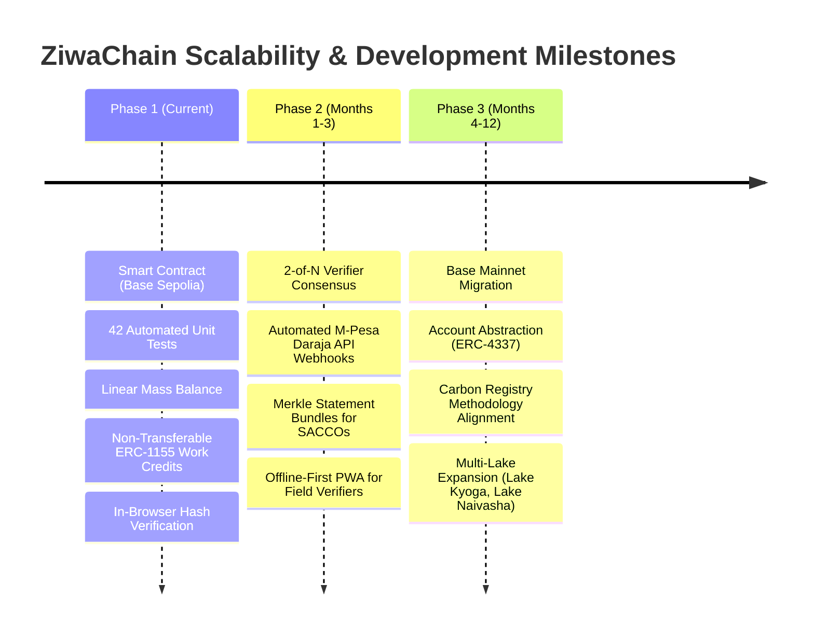

# ZiwaChain: Adoption Strategy & Scalability Roadmap

---

## 1. Adoption Strategy

Decentralized traceability projects in developing markets frequently fail because they impose blockchain complexity (private key management, seed phrases, gas fees, Web3 browser extensions) on low-connectivity, non-technical stakeholders. 

**ZiwaChain's core strategy is asymmetric participation:** informal harvesters engage through familiar 2G SMS and USSD telecom channels, while commercial aggregators, processors, and institutional verifiers operate Web3 interfaces.

```
┌────────────────────────────────┐       ┌────────────────────────────────┐
│      INFORMAL HARVESTERS       │       │       COMMERCIAL ACTORS        │
│ • No smartphone required       │       │ • EVM Wallets (Metamask/Safe)  │
│ • Basic SMS / USSD messaging   │  vs   │ • Physical inspection tablets  │
│ • Direct M-Pesa mobile money   │       │ • Industrial ERP integrations  │
│ • Paper/QR proof certificates  │       │ • Direct contract signing      │
└────────────────────────────────┘       └────────────────────────────────┘
```

### 1.1 The Harvester-First Entry Wedge
Harvesters face an immediate, tangible pain point: **payment disputes and lack of financial identity**. 
- **Immediate Value (Day 1):** Two-sided settlement co-signing via SMS ("YES 4821") creates an irrefutable receipt. If an aggregator claims a delivery was short-weighted or unpaid, the harvester has a cryptographically anchored record tied to the buyer's wallet and M-Pesa reference.
- **Medium-Term Value (Months 3–6):** Agricultural Savings and Credit Cooperatives (SACCOs) and lakeside micro-lenders require documentation of income regularity before underwriting loans for fishing boats, harvest equipment, or clean cookstoves. Harvesters can present their verified certificates to prove historical delivery consistency.
- **No Cost to Harvester:** All blockchain transaction gas fees are sponsored and abstracted by the ZiwaClear relayer.

### 1.2 Commercial Buyer & Processor Onboarding
Commercial enterprises turning invasive weeds into products (biogas digesters, organic soil conditioner manufacturers, fuel briquette producers) have commercial incentives to adopt ZiwaChain:
- **Traceable Feedstock:** Enables ESG compliance and chain-of-custody documentation for downstream corporate buyers and export certifications.
- **Fraud Prevention:** On-chain mass balance ensures middle-tier buying agents cannot invoice for phantom loads or double-count biomass across multiple supply contracts.
- **Simple Integration:** Standard EVM contract calls (`acceptBatch`, `recordProcessing`, `recordEndUse`) that integrate into existing logistics software via lightweight APIs.

### 1.3 Institutional & Donor Alignment
- **Results-Based Climate Finance:** International development agencies and climate funds (e.g., UNEP, USAID, climate impact DAOs) require verifiable evidence before disbursing outcome-based subsidies. ZiwaChain provides cryptographic proof of biomass removal and circular conversion without relying on self-reported spreadsheets.
- **Accredited Verification Partners:** Independent biological research stations on Lake Victoria (such as KMFRI – Kenya Marine and Fisheries Research Institute) can be provisioned with `VERIFIER_ROLE` to validate biomass quality and harvesting compliance.

---

## 2. Scalability Roadmap

The technical evolution of ZiwaChain is organized across three development horizons:



### Horizon 1: Hackathon Prototype (Current Milestone - Oct 2026)
- **Status:** **Completed & Built**
- Full core contract deployed and verified on Base Sepolia (`cancun` EVM target).
- 42 comprehensive unit tests validating stage monotonicity, role checks, mass-balance limits, non-transferability, and hash supersessions.
- Client-side canonical serialization (RFC 8785) and salted SHA-256/Keccak-256 payload hashing.
- Static, zero-backend public verification interface.

### Horizon 2: Commercial Pilot & Field Hardening (Q1 2027)
- **Multi-Verifier Consensus (2-of-N):** Upgrade `verifyBatch` to require threshold signatures from both an independent ecological verifier and a community landing-site elder, eliminating single-verifier collusion.
- **Automated Settlement Reconciliation:** Connect the relayer directly to Safaricom’s M-Pesa Daraja B2C API webhooks to automatically trigger `confirmSettlement` upon transaction receipt matching.
- **Lender Statement Bundles:** Implement an off-chain Merkle tree generator allowing a harvester to combine 30 discrete batch certificates into a single Merkle root. A SACCO loan officer can verify the harvester's cumulative 6-month delivery volume with one zero-knowledge or cryptographic membership proof, preserving privacy over individual transactions.
- **Offline-First Verifier PWA:** Progressive Web Application for field inspectors with local cryptographic signing and queue synchronization over intermittent lakeside 2G/3G connectivity.

### Horizon 3: Multi-Lake Ecosystem & Carbon Methodology Alignment (Q2–Q4 2027)
- **Base Mainnet Deployment:** Transition from testnet to Base L2 mainnet, leveraging sub-cent gas fees and Ethereum Layer-1 security guarantees.
- **ERC-4337 Account Abstraction:** Assign smart contract account wallets to harvester groups, managed via social recovery and session keys, giving informal collectives self-sovereign control over accumulated work credits.
- **Carbon Registry Methodology Certification:** Partner with carbon methodology developers to establish an accredited aquatic biomass removal methodology (targeting Verra or Gold Standard), allowing future work credits to bridge into accredited voluntary carbon offsets.
- **Regional Lake Expansion:** Extend protocol deployment to additional water bodies severely afflicted by aquatic weed blooms across East Africa, including Lake Kyoga, Lake Albert, and Lake Naivasha.

---

## 3. Adoption Barriers & Realistic Mitigations

| Barrier / Dependency | Honest Risk Assessment | Mitigation Strategy |
|---|---|---|
| **Lender Hesitation** | SACCOs may be slow to accept digital cryptographic certificates rather than stamped paper slips. | Partner with 1 pilot agricultural SACCO in Kisumu County; co-design the loan verification report format to match their existing underwriting templates. |
| **Telecom Gateway Reliability** | Network downtime or USSD timeouts on rural landing beaches can delay harvest reporting. | ZiwaClear relayer incorporates retry queues with local time-stamped delivery buffers; emergency SMS fallback numbers. |
| **Verifier Collusion** | A corrupt field inspector could approve fictitious wet mass for a kickback. | Implement 2-of-N multi-verifier threshold; require physical weigh-scale photo hashes; cross-check landed biomass against downstream buyer accepted weight via mass-balance limits. |
| **Relayer Centralization** | In early phases, ZiwaClear operates the relayer key, representing an operational dependency. | Transition the relayer role to a decentralized relayer network (or Chainlink Functions / Gelato Web3 Automations) with multi-organization signing in Phase 2. |
