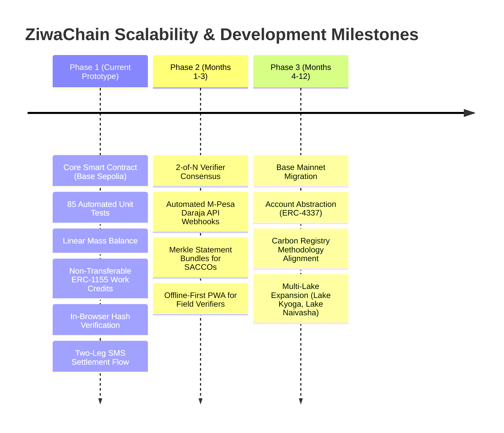

# ZiwaChain: Adoption Strategy & Scalability Roadmap

**Track:** Sustainable Supply Chains & Circular Economy  
**Target Geography:** Winam Gulf, Lake Victoria, Kenya (Kisumu, Siaya, and Homa Bay Counties)  

---

## 1. Adoption Strategy & The Proof Acceptance Pathway

Decentralized traceability projects in developing markets frequently fail because they impose blockchain complexity (private key management, seed phrases, gas fees, Web3 browser extensions) on low-connectivity, non-technical stakeholders. 

**ZiwaChain's core strategy is asymmetric participation:** informal harvesters engage through familiar 2G SMS and USSD telecom channels, while commercial aggregators, processors, and institutional verifiers operate Web3 interfaces.

```
┌────────────────────────────────┐       ┌────────────────────────────────┐
│      INFORMAL HARVESTERS       │       │       COMMERCIAL ACTORS        │
│ • No smartphone required       │       │ • EVM Wallets (Metamask/Safe)  │
│ • Basic SMS / USSD messaging   │  vs   │ • Physical inspection tablets  │
│ • Direct M-Pesa mobile money   │       │ • Industrial ERP integrations  │
│ • Paper/QR proof certificates  │       │ • Direct contract signing      │
└────────────────────────────────┘       └────────────────────────────────┘
```

### 1.1 Who Accepts the Proof: A Three-Tiered Adoption Pathway

We recognize that claiming third-party institutions will immediately accept on-chain certificates on day one is unrealistic. We define an honest, progressive adoption pathway:

```
Tier 1 (Built & Operational Now)
Dispute Settlement between Harvesters, Buyers, and Aggregators
        │
        ▼
Tier 2 (Months 3 to 6: Pilot Phase)
Credit Underwriting by Agricultural SACCOs and Micro-Lenders
        │
        ▼
Tier 3 (Months 6 to 12: Scaling Phase)
Results-Based Climate Subsidies & Corporate ESG Audit Validation
```

#### Tier 1: Dispute Settlement (Operational Now)
- **Who Accepts:** Frontline harvesters, commercial biomass buyers, and ZiwaClear dispute resolution staff.
- **The Problem It Solves:** Harvesters regularly face predatory weight discounting, where middlemen claim deliveries contained 30% water/mud or falsely claim payment was sent.
- **How It Works Today:** The commercial buyer commits their accepted weight on-chain via `acceptBatch` and commits the M-Pesa transaction reference hash (`paymentRefHash`). The harvester co-signs receipt via SMS ("YES 4821"), triggering `confirmSettlement`. Both parties hold an immutable record of agreed kilograms and payment receipt. If a dispute arises, the certificate serves as decisive proof.

#### Tier 2: Micro-Lenders and SACCOs (Next Phase, Months 3 to 6)
- **Who Accepts:** Lakeside Savings and Credit Cooperatives (SACCOs) and microfinance institutions (MFIs) operating in Kisumu, Bondo, and Homa Bay.
- **The Problem It Solves:** Informal harvesters lack formal payslips, bank statements, or collateral, barring them from loans for fishing nets, safety equipment, or clean cookstoves.
- **How It Works:** Rather than requiring loan officers to understand blockchain transactions, harvesters present their physical QR certificates or text their Crockford Base32 short code (e.g. `TR8NZ-A9VC5`). The loan officer opens the static verify page ([https://ziwachain.org/verify](https://ziwachain.org/verify)), which recomputes hashes and verifies historical delivery consistency directly against Base Sepolia.

#### Tier 3: Results-Based Climate Funders & Donors (Months 6 to 12)
- **Who Accepts:** International development agencies (e.g., USAID, UNEP), climate impact funds, and corporate ESG off-takers purchasing clean fuel briquettes.
- **The Problem It Solves:** Outcome-based funding programs routinely suffer from fraudulent reporting and phantom biomass claims when relying on self-reported Excel sheets.
- **How It Works:** Funders disburse catalytic subsidies based on verified kilograms diverted to end use, validated through on-chain `WORK_CREDIT` mint events and independent verifier signatures (`VERIFIER_ROLE`).

---

## 2. Pilot Implementation Plan (Winam Gulf, Kisumu)

To transition from protocol prototype to live lakeside deployment, we have designed a structured 6-month commercial pilot:

### 2.1 Pilot Geography & Landing Beach Hubs
We focus on three primary landing beach hubs in the Winam Gulf with severe hyacinth accumulation:
1. **Dunga Beach (Kisumu County):** Urban-adjacent landing beach with active cooperative harvester groups and proximity to bio-digester installations.
2. **Usenge Beach (Siaya County):** Open-lake entry point experiencing heavy seasonal drift mats from Ugandan and Tanzanian waters.
3. **Kendu Bay (Homa Bay County):** Shallow, highly eutrophic bay with active fuel briquette manufacturing groups.

### 2.2 Operational Targets & Metrics
- **Harvester Enrollment:** 150 informal harvesters organized across 6 landing beach management units (BMUs).
- **Biomass Volume Target:** 2,500 metric tons of wet hyacinth collected, verified, and processed over 180 days.
- **Commercial Off-Taker Partners:** 
  - Local biogas digester operators (displacing institutional firewood).
  - Clean fuel briquette micro-enterprises in Kisumu.
- **Independent Verification Partner:** Accredited biological research officers from KMFRI (Kenya Marine and Fisheries Research Institute) or regional county agricultural extension officers provisioned with `VERIFIER_ROLE`.

---

## 3. Scalability Roadmap

The technical evolution of ZiwaChain is organized across three development horizons:



### Horizon 1: Hackathon Prototype (Current Milestone, Oct 2026)
- **Status: Completed & Built**
- Full core contract deployed and verified on Base Sepolia (`cancun` EVM target).
- 85 comprehensive unit tests validating stage monotonicity, role checks, mass-balance limits, non-transferability, hash supersessions, and SMS settlement flows.
- Client-side canonical serialization (RFC 8785) and salted SHA-256/Keccak-256 payload hashing.
- Static, zero-backend public verification interface ([web/](file:///home/grace/Projects/CODEINE/hackathonTingz/ZiwaChain/web/)).
- Complete two-leg SMS settlement and PROOF flow engine with phone privacy masking ([src/sms/](file:///home/grace/Projects/CODEINE/hackathonTingz/ZiwaChain/src/sms/)).

### Horizon 2: Commercial Pilot & Field Hardening (Q1 2027)
- **Multi-Verifier Consensus (2-of-N):** Upgrade `verifyBatch` to require threshold signatures from both an independent ecological verifier and a community beach elder, eliminating single-verifier collusion.
- **Automated Settlement Reconciliation:** Connect the relayer directly to Safaricom's M-Pesa Daraja B2C API webhooks to automatically trigger `confirmSettlement` upon transaction receipt matching.
- **Lender Statement Bundles:** Implement an off-chain Merkle tree generator allowing a harvester to combine 30 discrete batch certificates into a single Merkle root. A SACCO loan officer can verify the harvester's cumulative 6-month delivery volume with one zero-knowledge or cryptographic membership proof, preserving privacy over individual transactions.
- **Offline-First Verifier PWA:** Progressive Web Application for field inspectors with local cryptographic signing and queue synchronization over intermittent lakeside 2G/3G connectivity.

### Horizon 3: Multi-Lake Ecosystem & Carbon Methodology Alignment (Q2 to Q4 2027)
- **Base Mainnet Deployment:** Transition from testnet to Base L2 mainnet, leveraging sub-cent gas fees and Ethereum Layer-1 security guarantees.
- **ERC-4337 Account Abstraction:** Assign smart contract account wallets to harvester groups, managed via social recovery and session keys, giving informal collectives self-sovereign control over accumulated work credits.
- **Carbon Registry Methodology Certification:** Partner with carbon methodology developers to establish an accredited aquatic biomass removal methodology (targeting Verra or Gold Standard), allowing future work credits to bridge into accredited voluntary carbon offsets.
- **Regional Lake Expansion:** Extend protocol deployment to additional water bodies severely afflicted by aquatic weed blooms across East Africa, including Lake Kyoga, Lake Albert, and Lake Naivasha.

---

## 4. User Testing & Field Findings

### Field Findings
> [!NOTE]
> **Field Validation Status:**  
> `[TO BE ADDED AFTER KISUMU]`  
> Formal field user testing with rural harvester Beach Management Units (BMUs), weigh-scale operators, and local SACCO loan officers is scheduled for our upcoming deployment trials in Kisumu County. Test results, user experience observations regarding SMS latency, and feedback on short-code usability will be documented here following field completion.

---

## 5. Adoption Barriers & Realistic Mitigations

| Barrier / Dependency | Honest Risk Assessment | Mitigation Strategy |
|---|---|---|
| **Lender Hesitation** | SACCOs may be slow to accept digital cryptographic certificates rather than stamped paper slips. | Partner with 1 pilot agricultural SACCO in Kisumu County, co-designing the loan verification report format to match their existing underwriting templates. |
| **Telecom Gateway Latency** | Network downtime or USSD timeouts on rural landing beaches can delay harvest reporting. | The ZiwaClear relayer incorporates retry queues with local time-stamped delivery buffers and emergency SMS fallback numbers. |
| **Verifier Collusion** | A corrupt field inspector could approve fictitious wet mass for a kickback. | Implement 2-of-N multi-verifier threshold, require physical weigh-scale photo hashes, and cross-check landed biomass against downstream buyer accepted weight via mass-balance limits. |
| **Relayer Centralization** | In early phases, ZiwaClear operates the relayer key, representing an operational dependency. | Transition the relayer role to a decentralized relayer network (or Chainlink Functions / Gelato Web3 Automations) with multi-organization signing in Phase 2. |
