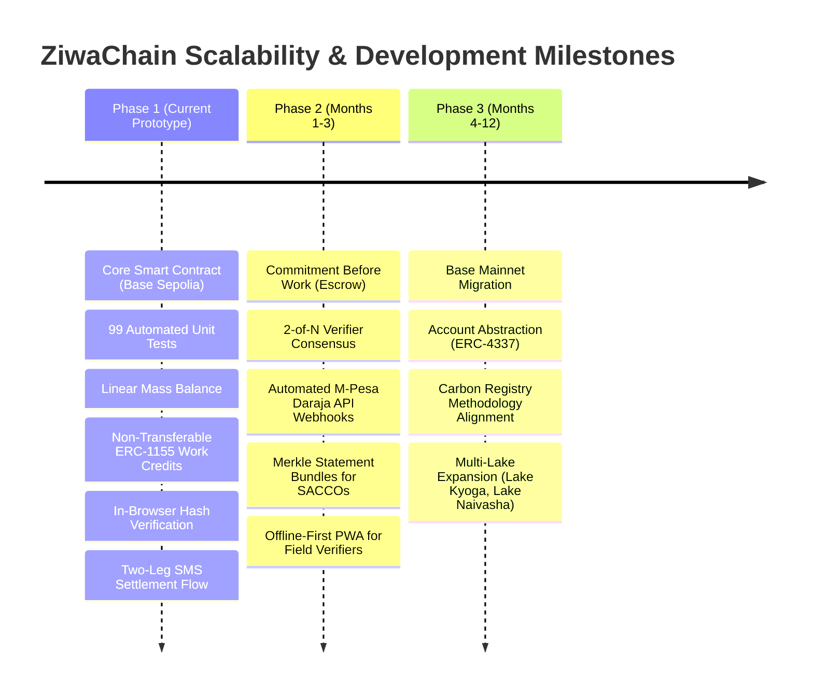

# ZiwaChain: Adoption Strategy & Scalability Roadmap

**Track:** Sustainable Supply Chains & Circular Economy  
**Target Geography:** Winam Gulf, Lake Victoria, Kenya (Kisumu, Siaya, and Homa Bay Counties)  

---

## 1. Adoption Strategy & The Proof Acceptance Pathway

Decentralized traceability projects in developing markets frequently fail because they impose blockchain complexity (private key management, seed phrases, gas fees, Web3 browser extensions) on low-connectivity, non-technical stakeholders. 

**ZiwaChain's core strategy is asymmetric participation:** informal harvesters engage through familiar 2G SMS and USSD telecom channels, while commercial aggregators, processors, and institutional verifiers operate Web3 interfaces.

```
┌────────────────────────────────┐       ┌────────────────────────────────┐
│      INFORMAL HARVESTERS       │       │       COMMERCIAL ACTORS        │
│ • No smartphone required       │       │ • EVM Wallets (Metamask/Safe)  │
│ • Basic SMS / USSD messaging   │  vs   │ • Physical inspection tablets  │
│ • Direct M-Pesa mobile money   │       │ • Industrial ERP integrations  │
│ • Paper/QR proof certificates  │       │ • Direct contract signing      │
└────────────────────────────────┘       └────────────────────────────────┘
```

### 1.1 Who Accepts the Proof: A Three-Tiered Adoption Pathway

We recognize that claiming third-party institutions will immediately accept on-chain certificates on day one is unrealistic. We define an honest, progressive adoption pathway:

```
Tier 1 (Built & Operational Now)
Dispute Settlement between Harvesters, Buyers, and Aggregators
        │
        ▼
Tier 2 (Months 3 to 6: Pilot Phase)
Credit Underwriting by Agricultural SACCOs and Micro-Lenders
        │
        ▼
Tier 3 (Months 6 to 12: Scaling Phase)
Results-Based Climate Subsidies & Corporate ESG Audit Validation
```

#### Tier 1: Dispute Settlement (Operational Now)
- **Who Accepts:** Frontline harvesters, the accepting and paying party (commercial processor, public works programme, or environmental funder, represented by the "buyer" role), and ZiwaClear dispute resolution staff. Note that no commercial buyer was validated in the field; downstream stages beyond verification are a pilot design with illustrative demo data.
- **The Problem It Solves:** Harvesters regularly face predatory weight discounting, where middlemen claim deliveries contained 30% water/mud or falsely claim payment was sent.
- **How It Works Today:** The accepting and paying party (holding `BUYER_ROLE`) commits their accepted weight on-chain via `acceptBatch` and commits the M-Pesa transaction reference hash (`paymentRefHash`). The harvester co-signs receipt via SMS ("YES 4821"), triggering `confirmSettlement`. Both parties hold an immutable record of agreed kilograms and payment receipt. If a dispute arises, the certificate serves as decisive proof.

#### Tier 2: Micro-Lenders and SACCOs (Next Phase, Months 3 to 6)
- **Who Accepts:** Lakeside Savings and Credit Cooperatives (SACCOs) and microfinance institutions (MFIs) operating in Kisumu, Bondo, and Homa Bay.
- **The Problem It Solves:** Informal harvesters lack formal payslips, bank statements, or collateral, barring them from loans for fishing nets, safety equipment, or clean cookstoves.
- **How It Works:** Rather than requiring loan officers to understand blockchain transactions, harvesters present their physical QR certificates or text their Crockford Base32 short code (e.g. `TR8NZ-A9VC5`). The loan officer opens the static verify page ([https://ziwachain.org/verify](https://ziwachain.org/verify)), which recomputes hashes and verifies historical delivery consistency directly against Base Sepolia.

#### Tier 3: Results-Based Climate Funders & Donors (Months 6 to 12)
- **Who Accepts:** International development agencies (e.g., USAID, UNEP), climate impact funds, and corporate ESG off-takers purchasing clean fuel briquettes.
- **The Problem It Solves:** Outcome-based funding programs routinely suffer from fraudulent reporting and phantom biomass claims when relying on self-reported Excel sheets.
- **How It Works:** Funders disburse catalytic subsidies based on verified kilograms diverted to end use, validated through on-chain `WORK_CREDIT` mint events and independent verifier signatures (`VERIFIER_ROLE`).

---

## 2. Pilot Implementation Plan (Winam Gulf, Kisumu)

To transition from protocol prototype to live lakeside deployment, we have designed a structured 6-month commercial pilot:

### 2.1 Pilot Geography & Landing Beach Hubs
We focus on three primary landing beach hubs in the Winam Gulf with severe hyacinth accumulation:
1. **Dunga Beach (Kisumu County):** Urban-adjacent landing beach with active cooperative harvester groups and proximity to bio-digester installations.
2. **Usenge Beach (Siaya County):** Open-lake entry point experiencing heavy seasonal drift mats from Ugandan and Tanzanian waters.
3. **Kendu Bay (Homa Bay County):** Shallow, highly eutrophic bay with active fuel briquette manufacturing groups.

### 2.2 Operational Targets & Metrics
- **Harvester Enrollment:** 150 informal harvesters organized across 6 landing beach management units (BMUs).
- **Biomass Volume Target:** 2,500 metric tons of wet hyacinth collected, verified, and processed over 180 days (pending seasonal weed arrival and dedicated off-take funding).
- **Accepting and Paying Off-Takers (Buyer Role):**
  - Public works programmes or environmental donor funds (providing guaranteed pre-funded compensation).
  - Potential circular processors (local biogas digesters or clean fuel briquette micro-enterprises; note that no commercial buyer was validated in the field, and local biogas demonstration sites currently source their own feedstock).
- **Independent Verification Partner:** Beach Management Unit (BMU) officials, county fisheries officers, or accredited biological research officers from KMFRI (Kenya Marine and Fisheries Research Institute) provisioned with `VERIFIER_ROLE`.

---

## 3. Scalability Roadmap

The technical evolution of ZiwaChain is organized across three development horizons:



### Horizon 1: Hackathon Prototype (Current Milestone, Oct 2026)
- **Status: Completed and Built**
- Full core contract deployed and verified on Base Sepolia (`cancun` EVM target).
- 99 comprehensive unit tests validating stage monotonicity, role checks, mass-balance limits, non-transferability, hash supersessions, duplicate-evidence flagging, and SMS settlement flows.
- Client-side canonical serialization (RFC 8785) and salted SHA-256/Keccak-256 payload hashing.
- Static, zero-backend public verification interface ([web/](file:///home/grace/Projects/CODEINE/hackathonTingz/ZiwaChain/web/)).
- Complete two-leg SMS settlement and PROOF flow engine with phone privacy masking ([src/sms/](file:///home/grace/Projects/CODEINE/hackathonTingz/ZiwaChain/src/sms/)).
- On-chain duplicate-evidence flagging (`evidenceFirstBatch` registry and `EvidenceReused` event) surfaced via client-side amber notices.

### Horizon 2: Commercial Pilot and Field Hardening (Q1 2027)
- **Commitment Before Work (Payer Pre-Funding / Escrow):** A smart contract mechanism enabling the accepting and paying party (programme, donor fund, or processor) to commit or lock funds into escrow before harvesting begins. This gives harvesters verifiable certainty of payout before expending physical labor, directly overcoming harvester distrust after past registration fee scams. Today, payment occurs off-chain via M-Pesa, and the chain records a payment reference hash and the harvester's two-way SMS confirmation.
- **Multi-Verifier Consensus (2-of-N):** Upgrade `verifyBatch` to require threshold attestations from both an independent ecological verifier (e.g. county fisheries officer) and a community beach elder or BMU official, eliminating single-verifier collusion.
- **Automated Settlement Reconciliation:** Connect the relayer directly to Safaricom's M-Pesa Daraja B2C API webhooks to automatically trigger `confirmSettlement` upon transaction receipt matching.
- **Lender Statement Bundles:** Implement an off-chain Merkle tree generator allowing a harvester to combine 30 discrete batch certificates into a single Merkle root. A SACCO loan officer can verify the harvester's cumulative 6-month delivery volume with one cryptographic membership proof, preserving privacy over individual transactions.
- **Offline-First Verifier PWA:** Progressive Web Application for field inspectors with local cryptographic signing and queue synchronization over intermittent lakeside 2G/3G connectivity.
- **Verifier Correction Request State (Roadmap, not built):** A state allowing a verifier to flag a batch for correction before issuing a final attestation, without the current binary approve/reject outcome.

### Horizon 3: Multi-Lake Ecosystem & Carbon Methodology Alignment (Q2 to Q4 2027)
- **Base Mainnet Deployment:** Transition from testnet to Base L2 mainnet, leveraging sub-cent gas fees and Ethereum Layer-1 security guarantees.
- **ERC-4337 Account Abstraction:** Assign smart contract account wallets to harvester groups, managed via social recovery and session keys, giving informal collectives self-sovereign control over accumulated work credits.
- **Carbon Registry Methodology Certification:** Partner with carbon methodology developers to establish an accredited aquatic biomass removal methodology (targeting Verra or Gold Standard), allowing future work credits to bridge into accredited voluntary carbon offsets.
- **Regional Lake Expansion:** Extend protocol deployment to additional water bodies severely afflicted by aquatic weed blooms across East Africa, including Lake Kyoga, Lake Albert, and Lake Naivasha.
- **External Evidence Connectors (Roadmap, not built):** Importers that accept evidence hashes and attestations from satellite platforms, field-sensor systems, or third-party ESG tools via the existing `source` label and `hotspotRef` hash field.
- **Export Mappings (Roadmap, not built):** Adapter libraries that translate ZiwaChain event logs into formats used by other traceability or reporting systems.

---

## 4. Existing Tools and Complementary Systems

ZiwaChain is designed as a provenance and verification layer that sits alongside existing satellite monitoring tools, ESG reporting platforms, and field data systems. It does not compete with those tools; it records whether their outputs were used and whether they were accepted by independent parties.

The contract's `hotspotRef` field is a `bytes32` hash of an off-chain hotspot record. The `source` label (stored in the off-chain payload) identifies which system supplied the hotspot data. This means that evidence gathered by satellite platforms or sensor networks can be referenced by hash without any change to the core contract. A verifier who uses a third-party field data tool can record the hash of that tool's output as `evidenceHash`, tying external evidence directly to the on-chain attestation.

ZiwaChain makes no claims about the features or limitations of any named external product. If an external system can produce a deterministic hash of its output, that output can serve as evidence in ZiwaChain without further integration work.

Complementary roles by current contract support:
- Satellite or aerial imaging: `hotspotRef` and `source` accept a hash of any platform's output. Supported by the current contract.
- Field sensor or weighbridge output: hash can be passed as `evidenceHash` during `verifyBatch`. Supported by the current contract.
- ESG reporting or carbon registry platforms: can consume ZiwaChain event logs directly via the public Base Sepolia RPC. Export mapping adapters to align with specific schema formats are roadmap, not built.

---

## 5. User Testing and Field Findings

### Provisional Field Findings

> [!NOTE]
> **Source Facts & Sample Limits (Provisional):**
> These observations are based on two days of informal fieldwork conducted around Dunga Beach, Homa Bay, and Kendu Bay on Lake Victoria between October 18 and October 19, 2026, across a small number of informal conversations with fishers and local residents. They reflect conditions at those specific sites and must not be generalized lake-wide. To protect privacy and adhere to research protocols, no individual person or organization is named.

The field inquiry revealed several critical grounded insights:
- **Ecological Dynamics & Seasonality:** Fishers describe water hyacinth as arriving around July and leaving around August, typically causing about a week of lost fishing when a landing is blocked. At Dunga, fishers and locals stated that water hyacinth has been absent for approximately three years. At Homa Bay, the shoreline had minimal weed during the visit. Kendu Bay exhibited a localized blockage that trapped fishing vessels. Reports that weed mats originate on the northern shore (Uyoma) are second-hand and unverified.
- **Local Removal Practices:** Where weed is removed, fishers clear narrow paths around their boats and leave the weed on the shore to dry aerobically. Other fishers choose to wait out the blockage until wind currents shift the mats.
- **Trust in Paid Harvesting:** Fishers reported that they would harvest hyacinth if paid, but they expect immediate payment and carry deep distrust of paid harvesting schemes following a reported scam where participants paid upfront registration fees and the organizer disappeared.
- **Funder-Side Trust Concern:** Parties reportedly claimed to be managing the weed after obtaining funding, but in practice waited for it to recede naturally. This is a second reported scam, on the funder side, alongside the reported harvester-side registration-fee scam. The observation is provisional and does not establish what happened in any particular case.
- **Buyer & Off-Taker Landscape:** No dependable commercial buyer was found. A local biogas demonstration site at Dunga sources its own feedstock and does not purchase external biomass, meaning it is not a validated commercial buyer.
- **Information Flow:** Information in the landing beaches flows strictly through county fisheries officers and Beach Management Unit (BMU) officials down to frontline fishers.
- **Pilot Design Status:** Downstream chain-of-custody stages beyond verification (buyer acceptance, processing, and end use) are a pilot design with illustrative demo data.

### Who Would Accept the Certificate

- **Natural Verifiers (BMU Officials & County Fisheries Officers):** Because information already flows through county fisheries officers and Beach Management Unit (BMU) leaders down to fishers, these actors are the natural verifiers for landed weed. They possess local standing and physical oversight of beach landings.
- **Possible Payers (County Programmes, NGOs/Donors, Processors):** The "buyer" role in ZiwaChain represents the accepting and paying party. Potential payers include county public works programmes (financing manual lake clearing as civic infrastructure), environmental NGOs and climate donors (funding biodiversity restoration), and future biogas or organic fertilizer processors. None of these commercial off-takers was validated in the field.
- **Prospective Users of Verified Removal Evidence (Hypothesis):** Funders and county programmes may use verified activity evidence to decide what to pay against and to review whether funded removal was recorded. This is a prospective adoption hypothesis, not validated demand.
- **Community Lenders (Agricultural SACCOs):** Lakeside savings and credit cooperatives can evaluate the tamper-evident certificate to assess seasonal income stability and loan eligibility for equipment or fishing gear.

### What Costly Problem It Solves for Them

- **For Harvesters:** Eliminates unrecorded deliveries and predatory off-chain discounting by providing a portable, tamper-evident proof of delivery and payment confirmation that they can hold on basic 2G phones or paper.
- **For Payers and Donors:** Eliminates phantom biomass and fraudulent reporting by anchoring disbursements to verified mass-balance records and physical verifier attestations.
- **For Verifiers and BMUs:** Formalizes beach landing records and replaces easily lost paper manifests with immutable digital delivery receipts.

### What Could Make Them Reject It (Pilot Hypotheses to Test)

1. **Distrust After the Reported Scam:** Fishers may suspect any formal registration or organized collection scheme is a cover for advance fee demands. *Hypothesis to test: Harvesters will participate only if registration is zero-cost and payment commitment is transparently locked upfront.*
2. **Expectation of Immediate Pay:** Fishers operate in a daily cash economy and expect payment immediately upon delivery. *Hypothesis to test: If off-chain M-Pesa disbursement experiences delays or multi-day batching, harvesters will abandon the digital workflow.*
3. **No Clear Payer:** In the absence of validated commercial buyers, certificates cannot drive sustained collection without public or philanthropic funding. *Hypothesis to test: Removal activities depend entirely on whether county governments or donor programmes sponsor the `BUYER_ROLE` payment pool.*
4. **Friction with Paper vs Digital Workflows:** Rural BMU officials or harvesters without smartphones may struggle with QR codes or digital short codes. *Hypothesis to test: Bilingual printed certificates and SMS-based short codes bridge the usability gap for non-smartphone users.*

---

## 6. Adoption Barriers & Realistic Mitigations

| Barrier / Dependency | Honest Risk Assessment | Mitigation Strategy |
|---|---|---|
| **Lender Hesitation** | SACCOs may be slow to accept digital cryptographic certificates rather than stamped paper slips. | Partner with 1 pilot agricultural SACCO in Kisumu County, co-designing the loan verification report format to match their existing underwriting templates. |
| **Telecom Gateway Latency** | Network downtime or USSD timeouts on rural landing beaches can delay harvest reporting. | The ZiwaClear relayer incorporates retry queues with local time-stamped delivery buffers and emergency SMS fallback numbers. |
| **Verifier Collusion** | A corrupt field inspector could approve fictitious wet mass for a kickback. | Implement 2-of-N multi-verifier threshold, require physical weigh-scale photo hashes, and cross-check landed biomass against downstream buyer accepted weight via mass-balance limits. |
| **Relayer Centralization** | In early phases, ZiwaClear operates the relayer key, representing an operational dependency. | Transition the relayer role to a decentralized relayer network (or Chainlink Functions / Gelato Web3 Automations) with multi-organization signing in Phase 2. |
