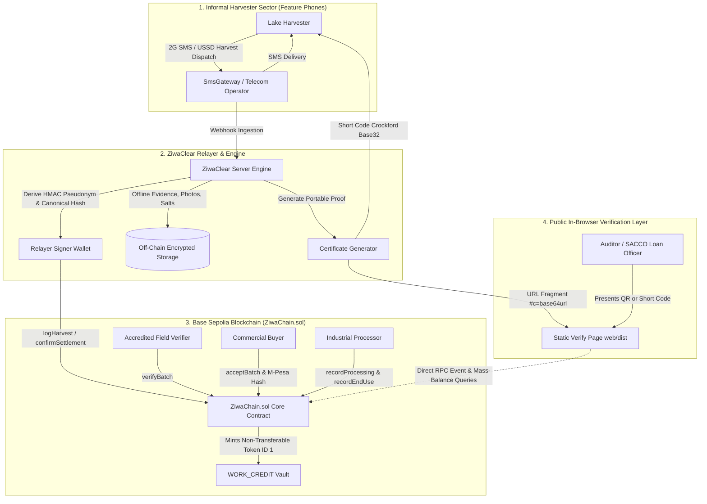
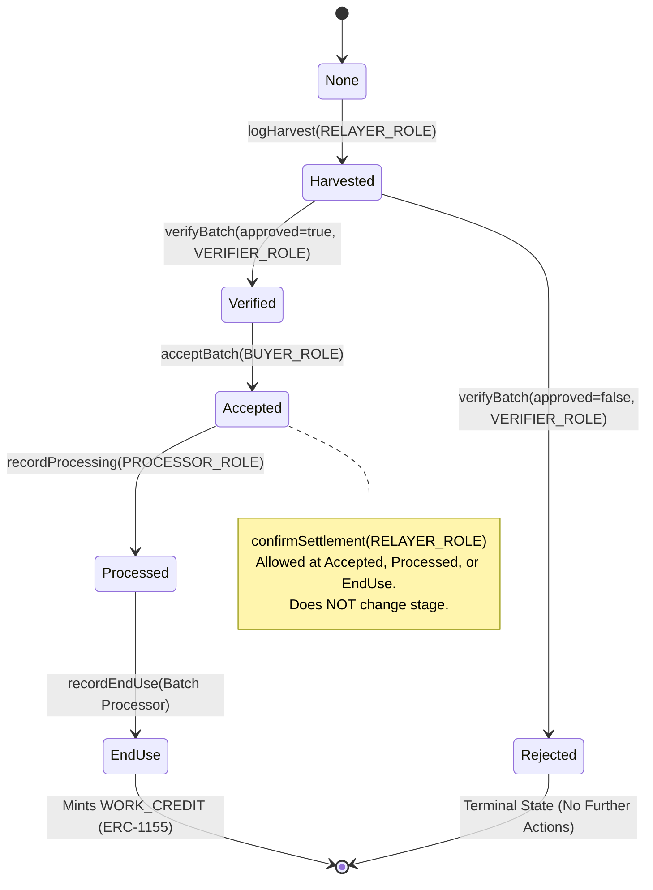
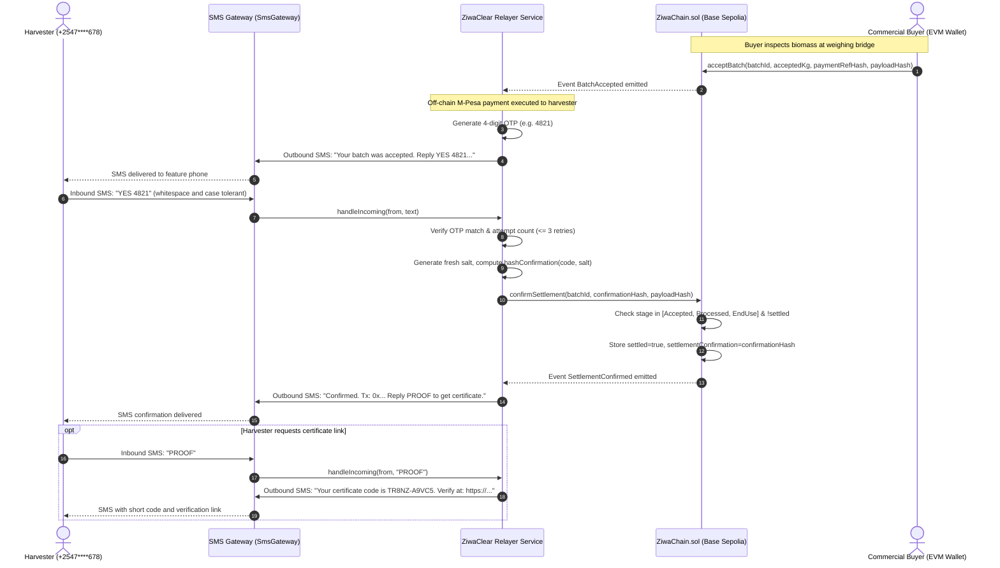

# ZiwaChain: System Architecture Specification

**Track:** Sustainable Supply Chains & Circular Economy  
**Target Deployment:** Base Sepolia (Solidity 0.8.28, EVM Cancun)  

---

## 1. System Overview & Component Architecture

ZiwaChain is an on-chain provenance and custody tracking protocol designed specifically for informal water hyacinth harvesting across Lake Victoria. We recognize that rural harvesters operating in lakeside landing beaches do not possess smartphones, Web3 wallets, or crypto assets to pay gas. Consequently, ZiwaChain implements an asymmetric architecture: informal workers interact purely through standard SMS and USSD telecom rails, while commercial buyers, field verifiers, and bio-processors interact via authenticated EVM smart contract transactions.

### Component Breakdown

1. **Harvester Interface (SMS/USSD):** Harvesters report deliveries (bags, harvest location, group identifier) using 2G/3G basic phones. In the prototype, this SMS gateway is simulated (`src/sms/SimulatedGateway.ts`); production integration with a commercial telecom provider is planned.
2. **ZiwaClear Relayer (`RELAYER_ROLE`):** Ingests harvest dispatches, derives per-batch un-linkable pseudonyms, formats canonical RFC 8785 JSON payloads, generates cryptographic salts, and broadcasts `logHarvest` transactions on Base Sepolia. The relayer sponsors all network gas fees.
3. **Field Verifiers (`VERIFIER_ROLE`):** Independent inspectors stationed at landing beaches (natural verifiers: Beach Management Unit officials and county fisheries officers). Note: physical field inspection, weighbridge checks, and intake sampling describe the intended real-world process and are not built into the software; in prototype demonstrations, these roles are simulated via demo accounts.
4. **Accepting and Paying Parties / Buyers (`BUYER_ROLE`):** The accepting and paying party: whether a commercial processor, a public works programme, or an environmental donor fund. They inspect deliveries, submit `acceptBatch` on-chain, and record the hash of the off-chain M-Pesa mobile money payout. Note that no commercial buyer was validated in the field; in the prototype, buyer transactions and M-Pesa references use illustrative demo data.
5. **Industrial Processors (`PROCESSOR_ROLE`):** Biogas, pyrolysis, or organic fertilizer plants. They log biomass conversion through `recordProcessing` and `recordEndUse`, triggering the on-chain minting of work credits.
6. **Smart Contract (`ZiwaChain.sol`):** Deployed on Base Sepolia, enforcing role permissions, irreversible linear stage transitions, conservation of mass balance, duplicate-evidence flagging, non-transferable credit issuance, and append-only hash supersessions.
7. **Certificate Generator (`src/certificate/`):** Generates portable Version 1 JSON certificates containing canonical payloads, salts, on-chain transaction references, Crockford Base32 short codes, and self-verifying QR codes.
8. **Public Verify Page (`web/`):** A zero-backend static client bundled with esbuild. Queries Base Sepolia directly via public JSON-RPC to recompute hashes and audit batches with zero server tracking.
9. **Illustrative Demo Data & Pilot Design Note:** All demo batches (Batches A, B, C, and D) in `demo/demo-data.json` are illustrative demo data generated by a local seed script, not records of real harvests. Field observations are provisional (based on informal fieldwork around Dunga, Homa Bay, and Kendu Bay on Lake Victoria, Oct 18 to 19, 2026), and chain-of-custody stages beyond verification are a pilot design with illustrative demo data.

---

## 2. On-Chain State Machine

A batch progresses through an irreversible linear sequence of stages. No stage can be skipped, and stage regressions are strictly barred by the contract:

### Stage Definitions

| Stage | Enum Value | Permitted Role | Description | Next Valid Stage |
|---|---|---|---|---|
| `None` | 0 | Public | Initial empty state for un-initialized batch identifier | `Harvested` |
| `Harvested` | 1 | `RELAYER_ROLE` | Harvest weight, hotspot reference, and harvester pseudonym anchored | `Verified` or `Rejected` |
| `Verified` | 2 | `VERIFIER_ROLE` | Physical moisture and contamination check passed | `Accepted` |
| `Rejected` | 3 | `VERIFIER_ROLE` | Quality failure or contamination. Terminal state, batch cannot advance | *None (Terminal)* |
| `Accepted` | 4 | `BUYER_ROLE` | Commercial off-taker accepted mass, anchors M-Pesa payment hash | `Processed` |
| `Processed` | 5 | `PROCESSOR_ROLE` | Biomass accepted into conversion process (e.g., anaerobic digestion) | `EndUse` |
| `EndUse` | 6 | Assigned Processor | Conversion complete into biochar, briquettes, or compost. Mints work credits | *None (Accumulative)* |

---

## 3. Settlement Confirmation Sequence

Disputes in informal supply chains frequently occur when buyers claim payment was sent but harvesters never received it, or when buyers underpay agreed weights. ZiwaChain settles this through a two-sided cryptographic co-signing sequence:

---

## 4. On-Chain vs Off-Chain Data Boundary

We maintain a strict boundary between public blockchain state and private off-chain operational data to ensure zero personal identifiable information (PII) leaks onto Base Sepolia:

| Data Element | Storage Location | Privacy & Integrity Mechanism |
|---|---|---|
| `batchId` | On-Chain (`bytes32`) | Unique keccak256 hash derived from harvest intake timestamp, landing site, and batch sequence. |
| Stage & Lifecycle Status | On-Chain (`enum Stage`) | Strictly monotonic state machine enforced by smart contract logic. |
| Harvested Mass (`quantityKg`) | On-Chain (`uint256`) | Whole integer kilograms recorded at harvest intake. |
| Accepted Mass (`acceptedKg`) | On-Chain (`uint256`) | Enforced by mass-balance invariant: `acceptedKg <= harvestedKg`. |
| Processed Intake (`processedKg`) | On-Chain (`uint256`) | Enforced by mass-balance invariant: `processedKg <= acceptedKg`. |
| End-Use Mass (`endUseKgTotal`) | On-Chain (`uint256`) | Enforced by mass-balance invariant: `sum(endUseKg) <= processedKg`. |
| Harvester Identity | On-Chain (`bytes32` Pseudonym) | Per-batch HMAC-SHA256 (`HMAC(secret, groupId || batchId)`). Un-linkable across batches. |
| Harvester Phone Number | Off-Chain Only | Masked in all logs (`+2547****678`). Never written to contract storage or event logs. |
| Field Evidence Photos & Lab Tests | Off-Chain (Stored in DB/IPFS) | Keccak256 evidence hash anchored on-chain (`evidenceHash`). |
| Stage Metadata (Timestamps, Geolocation) | Off-Chain (JSON in Certificate) | RFC 8785 canonical JSON combined with random 128-bit salt and hashed on-chain (`payloadHash`). |
| M-Pesa Mobile Money Reference | Off-Chain (In Certificate) | Plain text reference kept off-chain, `keccak256(paymentRef)` anchored on-chain (`paymentRefHash`). |
| Settlement Confirmation OTP | Off-Chain Memory (Temporary) | `keccak256(canonicalJson({type, code, salt}))` anchored on-chain (`confirmationHash`). |
| Work Credits (`WORK_CREDIT`) | On-Chain (`ERC-1155 Token 1`) | Non-transferable token minted 1:1 per kilogram reaching verified end use. |

---

## 5. System Roles & Access Control

Operational permissions are managed through OpenZeppelin Contracts v5 `AccessControl`. All administrative operations can transition to a community multi-signature vault without smart contract redeployment:

| Role Identifier | Assigned Entity | Responsibilities & Authorized Functions | Constraints & Security Controls |
|---|---|---|---|
| `DEFAULT_ADMIN_ROLE` | Deployer (Multi-Sig Roadmap) | Grants and revokes roles; emergency governance. | Does not execute operational lifecycle transactions. |
| `RELAYER_ROLE` | ZiwaClear Relayer Key | Calls `logHarvest` to ingest SMS reports; calls `confirmSettlement` upon harvester OTP reply; holds custodian work credits. | Cryptographically prohibited from acting as verifier (`VerifierCannotBeRelayer`). |
| `VERIFIER_ROLE` | Independent Biological Verifiers (e.g. KMFRI) | Calls `verifyBatch(batchId, approved, evidenceHash, payloadHash)` after physical moisture/contamination inspection. | Cannot hold `RELAYER_ROLE`. Can mark batch terminal `Rejected`. |
| `BUYER_ROLE` | Commercial Off-Takers (Biogas, Fertilizer, Briquettes) | Calls `acceptBatch(batchId, acceptedKg, paymentRefHash, payloadHash)`. | Cannot accept mass greater than `harvestedKg`. Requires verified stage. |
| `PROCESSOR_ROLE` | Conversion Plants | Calls `recordProcessing(batchId, processType, inputKg, outputUnits, payloadHash)`. | Assigned processor exclusively controls subsequent `recordEndUse` calls for that batch. |
