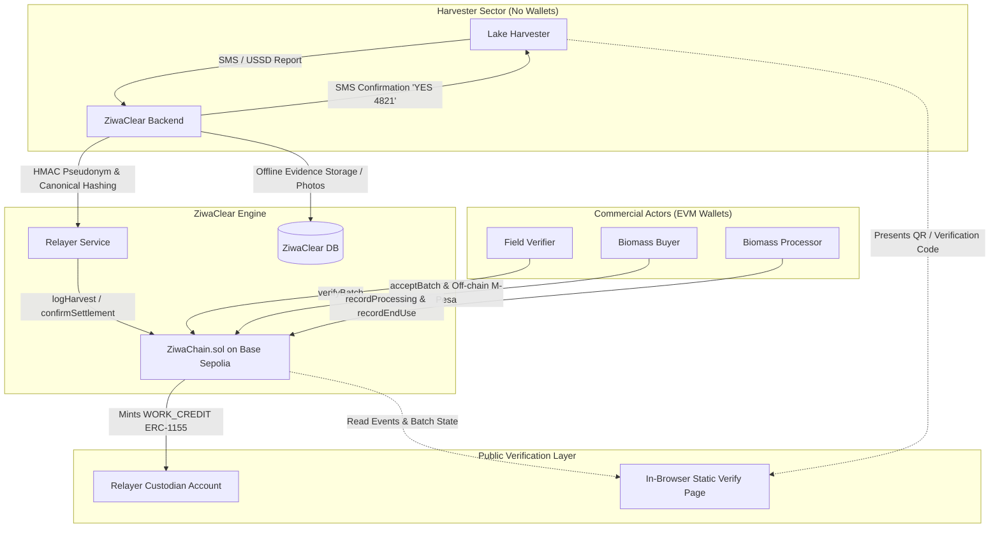
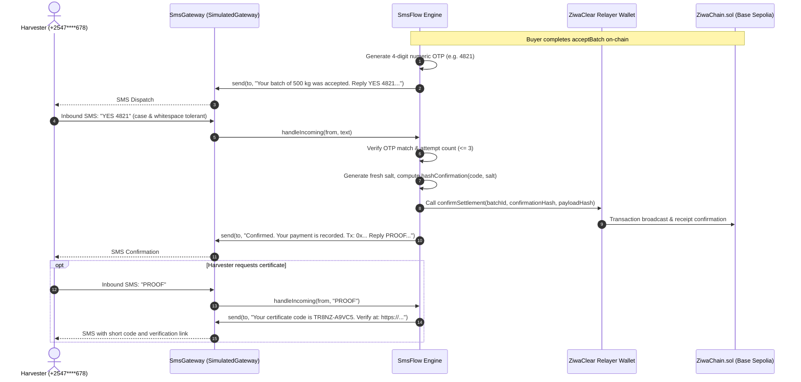

# ZiwaChain: Technical Architecture Specification

This document provides the complete technical architecture and smart contract specification for **ZiwaChain**. It details the on-chain state machine, system roles, data boundaries, cryptographic mechanisms, and the test suite proving every rule.

---

## 1. System Architecture



### Component Breakdown

1. **Harvester Interface (SMS/USSD):**
   - Harvesters operate in lakeside areas with basic feature phones (2G/3G).
   - Reports (harvester group ID, landing site, estimated bag count) arrive via telecom USSD/SMS gateway.
   - Harvesters do not manage private keys or gas fees.
2. **ZiwaClear Relayer (`RELAYER_ROLE`):**
   - Ingests SMS reports, computes salted payload hashes and per-batch pseudonyms, and submits `logHarvest` to the smart contract.
   - Acts as the custodian for non-transferable work credits on behalf of the harvester.
3. **Field Verifiers (`VERIFIER_ROLE`):**
   - Independent quality inspectors who physically sample biomass at the landing site.
   - Sign transactions using their own EVM wallets to call `verifyBatch` (approve or reject).
4. **Commercial Buyers (`BUYER_ROLE`):**
   - Off-takers purchasing hyacinth for bioenergy, biochar, briquettes, or organic compost.
   - Inspect weight, call `acceptBatch` with the accepted kilogram mass, and pay the harvester via M-Pesa.
5. **Biomass Processors (`PROCESSOR_ROLE`):**
   - Industrial processing facilities converting raw aquatic weeds into end products.
   - Call `recordProcessing` when biomass enters conversion and `recordEndUse` when end products are produced, triggering work credit issuance.
6. **Smart Contract (`ZiwaChain.sol`):**
   - Deployed on **Base Sepolia** (Solidity 0.8.28, EVM version `cancun`).
   - Enforces linear lifecycle, role permissions, mass balance, non-transferability, and hash supersession.
7. **Public Verify Page (Static Web App in `web/`):**
   - Zero-backend client. Reads Base Sepolia directly via JSON-RPC. Recomputes hashes in-browser to verify certificates against immutable chain events.
   - Enforces 5 distinct verification checks: client-side hash recomputation (RFC 8785 + keccak256), on-chain event log matching, record supersession audit (`supersededBy`), conservation of mass verification (`getBatch`), and M-Pesa payment reference hash confirmation.
   - Decodes certificate payloads strictly client-side from URL fragments (`#c=<base64url>`) without contacting any central server.
8. **Demo Batch Seed Runner (`scripts/seed.ts`):**
   - End-to-end deployment and execution harness that seeds illustrative demo batches on-chain (Batch A full journey, Batch B quality rejection, Batch C hash correction, Batch D duplicate evidence flag; illustrative demo data, not real harvests).
   - Operates on local in-memory nodes as well as Base Sepolia (automatically funding ephemeral actor wallets).
   - Emits canonical payloads, salts, hashes, and transaction receipts to `demo/demo-data.json` for certificate generation and verify page testing.
9. **Simulated SMS Gateway & Settlement Flow (`src/sms/`, `scripts/demoSms.ts`):**
   - Two-leg SMS flow for low-bandwidth harvesters: post-acceptance settlement OTP confirmation and on-demand PROOF certificate delivery.
   - The SMS gateway is simulated in the prototype (`SimulatedGateway` in `src/sms/gateway.ts`); live telecom integration (e.g. Africa's Talking) is planned for production. Field inspection and weighbridge checks also describe the intended real-world process and are executed by demo accounts in the prototype.
   - Strict phone number masking in logs and zero on-chain phone number storage.

---

## 2. On-Chain State Machine

A batch progresses through a strict, irreversible sequence of stages:

```
[None] 
   │
   ▼ logHarvest (RELAYER_ROLE)
[Harvested]
   │
   ├──► verifyBatch(approved=false) ──► [Rejected] (Terminal)
   │
   ▼ verifyBatch(approved=true) (VERIFIER_ROLE)
[Verified]
   │
   ▼ acceptBatch (BUYER_ROLE)
[Accepted] ◄─── confirmSettlement (RELAYER_ROLE, allowed at Accepted, Processed, or EndUse)
   │
   ▼ recordProcessing (PROCESSOR_ROLE)
[Processed]
   │
   ▼ recordEndUse (Batch Processor only)
[EndUse] ──► Mints WORK_CREDIT (ERC-1155)
```

### Stage Definitions

| Stage | Enum Value | Description | Permitted Callers | Next Valid Stages |
|---|---|---|---|---|
| `None` | `0` | Uninitialized batch ID | Anyone (state empty) | `Harvested` |
| `Harvested` | `1` | Harvest logged by relayer; awaiting verification | `RELAYER_ROLE` | `Verified`, `Rejected` |
| `Verified` | `2` | Approved by verifier; ready for buyer acceptance | `VERIFIER_ROLE` | `Accepted` |
| `Rejected` | `3` | **Terminal state.** Failed verification or quality inspection | `VERIFIER_ROLE` | *None* |
| `Accepted` | `4` | Buyer accepted volume; M-Pesa payment reference hashed | `BUYER_ROLE` | `Processed` |
| `Processed` | `5` | Intake confirmed by industrial conversion facility | `PROCESSOR_ROLE` | `EndUse` |
| `EndUse` | `6` | Biomass reached final circular destination; credits minted | Batch Processor | `EndUse` (partial calls) |

---

## 3. On-Chain Rules and Test Proofs

Every business rule is enforced natively in the smart contract and verified by automated unit tests in [test/ZiwaChain.ts](file:///home/grace/Projects/CODEINE/hackathonTingz/ZiwaChain/test/ZiwaChain.ts).

| Business Rule | Contract Invariant / Custom Error | Test in `test/ZiwaChain.ts` | Status |
|---|---|---|---|
| **Relayer Authorization** | Caller of `logHarvest` must hold `RELAYER_ROLE` | `"refuses anyone who does not hold RELAYER_ROLE"` | ✅ Passing |
| **Non-Zero Harvest** | `quantityKg > 0` (`InvalidQuantity`) | `"refuses a harvest of zero kg"` | ✅ Passing |
| **Unique Batch ID** | Batch stage must be `None` (`BatchAlreadyExists`) | `"refuses a batchId that already exists"` | ✅ Passing |
| **Verifier Authorization** | Caller of `verifyBatch` must hold `VERIFIER_ROLE` | Implied by `AccessControlUnauthorizedAccount` check | ✅ Passing |
| **Separation of Duties** | Verifier cannot hold `RELAYER_ROLE` (`VerifierCannotBeRelayer`) | `"stops a relayer from also acting as verifier"` | ✅ Passing |
| **Rejection Finality** | Stage `Rejected` is terminal; cannot advance | `"lets a verifier reject a harvest and makes Rejected terminal"` | ✅ Passing |
| **Stage Progression** | Transitions must follow sequence (`WrongStage`) | `"refuses acceptance when the batch is not at stage Verified"` | ✅ Passing |
| **Mass Balance (Buyer)** | `acceptedKg <= harvestedKg` (`MassBalanceViolation`) | `"refuses acceptedKg that exceeds harvestedKg (mass balance)"` | ✅ Passing |
| **Non-Zero Acceptance** | `acceptedKg > 0` (`InvalidQuantity`) | `"refuses an acceptedKg of zero"` | ✅ Passing |
| **Settlement Timing** | `confirmSettlement` allowed only at `Accepted`, `Processed`, or `EndUse` | `"refuses confirmation when the batch is at stage Harvested"` | ✅ Passing |
| **Once-per-Batch Settlement** | `settled == false` (`AlreadySettled`) | `"refuses a second confirmSettlement on the same batch"` | ✅ Passing |
| **Settlement Flexibility** | `confirmSettlement` does not alter stage or block credits | `"lets the relayer confirm settlement after processing"`, `"lets the relayer confirm settlement even after end use"` | ✅ Passing |
| **Mass Balance (Processing)** | `inputKg <= acceptedKg` (`MassBalanceViolation`) | `"refuses inputKg that exceeds acceptedKg (mass balance)"` | ✅ Passing |
| **Single Batch Processor** | `msg.sender == b.processor` in `recordEndUse` (`NotBatchProcessor`) | `"refuses recordEndUse from a different PROCESSOR_ROLE address"` | ✅ Passing |
| **Mass Balance (End Use)** | `endUseKgTotal + endUseKg <= processedKg` (`MassBalanceViolation`) | `"refuses endUseKg that would push endUseKgTotal above processedKg"`, `"refuses cumulative end-use that exceeds processedKg"` | ✅ Passing |
| **Partial End-Use Delivery** | Multiple partial calls accumulate `endUseKgTotal` | `"accumulates endUseKgTotal across multiple partial calls"` | ✅ Passing |
| **Credit Issuance (ERC-1155)** | 1 credit per kg minted to custodian; tracked in `workCreditsOf` | `"mints one WORK_CREDIT per kg to the custodian and emits CreditsIssued"`, `"accumulates workCreditsOf across multiple end-use calls"` | ✅ Passing |
| **Non-Transferability** | ERC-1155 `_update` blocks transfers and burns (`NonTransferable`) | `"blocks safeTransferFrom for work credits"`, `"blocks safeBatchTransferFrom for work credits"` | ✅ Passing |
| **Hash Authorship** | Only original author can correct a hash (`NotHashAuthor`) | `"refuses correction by an address that is not the original author"` | ✅ Passing |
| **Once-per-Hash Correction** | Superseded hash cannot be corrected twice (`HashAlreadySuperseded`) | `"refuses correcting a hash that has already been superseded"` | ✅ Passing |
| **Hash Reuse Prevention** | Replacement hash cannot already exist for batch (`CannotReuseHash`) | `"refuses reusing an already-registered hash as the replacement"` | ✅ Passing |
| **Unregistered Hash Check** | Target hash must exist on batch (`HashNotFound`) | `"refuses a hash that was never recorded for this batch"` | ✅ Passing |

---

## 4. Data Architecture & Storage Layout

### Batch Struct (`contracts/ZiwaChain.sol`)

```solidity
struct Batch {
    Stage   stage;                  // Current lifecycle stage
    address custodian;              // Relayer that submitted harvest; holds custody of credits
    address buyer;                  // Buyer wallet that signed acceptance
    address processor;              // Processor wallet that signed processing intake
    bytes32 harvesterId;            // Pseudonymous harvester identifier: HMAC-SHA256
    bytes32 hotspotRef;             // Keccak256 hash of off-chain hotspot telemetry
    uint256 harvestedKg;            // Harvested wet mass in kilograms
    uint256 acceptedKg;             // Buyer-accepted wet mass (<= harvestedKg)
    uint256 processedKg;            // Input mass consumed by processor (<= acceptedKg)
    uint256 endUseKgTotal;          // Cumulative end-use mass (<= processedKg)
    bytes32 paymentRefHash;         // Keccak256 of M-Pesa transaction reference
    bytes32 settlementConfirmation; // Keccak256 of harvester's SMS response
    bool    settled;                // True once settlement confirmation succeeds
}
```

### On-Chain vs Off-Chain Boundary

| Domain | Stored On-Chain (Base Sepolia) | Stored Off-Chain (ZiwaClear Database) |
|---|---|---|
| **Identity** | Roles, wallet addresses, pseudonymous `harvesterId` | Harvester full name, national ID, phone number |
| **Geospatial** | `hotspotRef` (keccak256 hash) | GPS coordinates, satellite multispectral tiles, polygon boundaries |
| **Evidence** | `evidenceHash`, `payloadHash` | Field photographs, moisture sensor logs, lab weigh-scale tickets |
| **Financial** | `paymentRefHash`, `settlementConfirmation` | M-Pesa receipt code, transaction fee, currency amount, recipient MSISDN |
| **Quantities** | Invariant mass variables (`harvestedKg`, `acceptedKg`, `processedKg`, `endUseKgTotal`) | Bag counts, moisture percentage, truck license plates |

---

## 5. Cryptographic Design

### 1. Harvester Pseudonymity (`harvesterId`)
Plain hashes of phone numbers (e.g., `keccak256(phone)`) are insecure because phone numbers have low entropy (~10 digits) and are trivial to rainbow-table brute force. ZiwaChain derives per-batch pseudonyms:
$$\text{harvesterId} = \text{HMAC-SHA256}(\text{ServerSecret}, \text{groupId} \parallel \text{batchId})$$
- **Unlinkability:** Each batch receives an unpredictable, distinct `bytes32` identifier. Observers on a public blockchain cannot correlate multiple batches to the same harvester.
- **Selective Disclosure:** The harvester can present certificates to a lender or buyer, allowing the verifier to prove ownership without exposing historical harvest activities to the public.

### 2. Canonical JSON Serialization (RFC 8785) & Payload Hash
To guarantee that the in-browser verification page calculates the exact same hash as the ZiwaClear backend, payloads follow RFC 8785 canonical JSON formatting (`src/hashing/canonical.ts`):
1. Object keys sorted lexicographically (Unicode UTF-16 code unit order).
2. Whitespace stripped (no indentation or superfluous spaces).
3. Numbers validated to enforce strict integer representation (rejecting floats, NaN, and Infinity).
4. Undefined, functions, and symbols strictly rejected.
5. Cryptographic salt (16 random bytes as 0x-prefixed hex, generated via browser-safe `crypto.getRandomValues` in `src/hashing/salt.ts`) combined with payload:
$$\text{payloadHash} = \text{keccak256}(\text{utf8}(\text{CanonicalJSON}(\{ \text{salt}, \text{payload} \}))) \quad (\texttt{src/hashing/hash.ts})$$
$$\text{confirmationHash} = \text{keccak256}(\text{utf8}(\text{CanonicalJSON}(\{ \text{type: "settlement_confirmation"}, \text{code}, \text{salt} \}))) \quad (\texttt{src/hashing/hash.ts})$$

Browser safety: All client verification modules (`canonical.ts`, `salt.ts`, `hash.ts`, `types.ts`) are completely browser-safe and avoid Node.js native dependencies. Only server-side pseudonym generation (`pseudonym.ts`) uses `node:crypto`.

Verified by 18 unit tests in `test/hashing.test.ts`.

### 3. Append-Only Tamper-Evident Corrections
The contract never overwrites historical data. If a field evidence hash or payload hash contained a typographical error, `correctRecord` records the replacement:
- Tracks `_hashAuthor[batchId][hash]` to restrict corrections strictly to the original submitter.
- Maps `_supersededByMap[batchId][oldHash] = newHash`.
- Emits `RecordCorrected(batchId, author, oldHash, newHash, reasonHash)`.
- Quantities cannot be altered via `correctRecord`, protecting mass balance invariants.

---

## 6. Harvester Certificate Architecture and Offline Verification

The harvester certificate serves as portable, self-contained proof. It enables any third party (such as an agricultural SACCO loan officer or corporate ESG auditor) to verify the authenticity of a harvest batch directly against Base Sepolia without requiring access to ZiwaClear's internal database (`src/certificate/build.ts`).

### Certificate Data Schema (Version 1)
```json
{
  "version": 1,
  "chainId": "31337",
  "contractAddress": "0x5FbDB2315678afecb367f032d93F642f64180aa3",
  "batchId": "0x2979c3606b661c258449350a53dd28384d5d42d8032e35ac9bc98739b5e17bcd",
  "pseudonym": "0x406cbc69950796e47fd36afe766ef07274c254b93613a8a61096a464436b8399",
  "deploymentBlock": 1,
  "stages": { ... },
  "paymentRef": "MPESA-QKH78219XZ-2026",
  "settlementConfirmation": { "code": "4821", "salt": "0x..." },
  "shortCode": "TR8NZ-A9VC5",
  "verifyUrl": "https://ziwachain.org/verify#c=ey..."
}
```

### Components
1. **Crockford Base32 Short Code (`src/certificate/shortCode.ts`):** A 10-character code derived from the harvest payload hash and formatted into two groups of 5 with a hyphen (e.g. `TR8NZ-A9VC5`). It excludes ambiguous characters (I, L, O, U) so harvesters can easily read it over phone calls or SMS.
2. **Compact Base64URL Encoding:** The certificate is encoded into a URL fragment (`#c=<base64url>`). Because URL fragments are never sent to web servers, the user's certificate payload remains strictly client-side when the verification page loads.
3. **High-Density QR Generator (`src/certificate/qr.ts`):** Generates PNG QR codes encoding the complete self-verifying URL. If payload size exceeds optical QR scanning density, it falls back to a query URL containing the on-chain identifiers.
4. **Batch Certificate Pipeline (`scripts/makeCertificates.ts`):** Automated pipeline that reads `demo/demo-data.json`, writes verified JSON certificates and PNG QR codes, and generates formal audit notes for rejected batches.

Verified by 6 unit tests in `test/certificate.test.ts`.

---

## 7. SMS Gateway and Harvester Settlement Flow

The harvester interaction layer (`src/sms/`) bridges the gap between rural informal harvesters and the Base Sepolia blockchain without requiring smartphones, Web3 wallets, or gas tokens.

### Interaction Sequence Diagram



### Key Technical Properties

1. **Plug-In Architecture (`src/sms/gateway.ts`):** The `SmsGateway` interface exposes two primary methods (`send(to, text)` and `onReceive(handler)`). In development and demonstration mode, `SimulatedGateway` formats messages as clean conversational terminal outputs. In production, a telecom gateway adapter (such as Africa's Talking or Twilio) implements `SmsGateway`, routing incoming webhook events to `onReceive` without touching the business logic in `src/sms/flow.ts`.
2. **Privacy and Phone Masking:** Phone numbers are strictly never written to the blockchain or logged in plaintext. The `maskPhone` function preserves operator routing visibility while masking internal digits (e.g., `+254712345678` -> `+2547****678`).
3. **Resilience & Rate Limiting:** Harvesters are given 3 attempts to provide the matching OTP. Exceeding 3 failed attempts invalidates the session and returns an operational support contact notice. Unrecognized phone numbers and malformed messages are silently ignored to prevent enumeration.
4. **Idempotency & Re-entry Defense:** If a second settlement confirmation is attempted for a batch that is already marked `settled` on-chain, the flow catches the contract revert gracefully and replies that the batch was already confirmed, preventing transaction crash or state corruption.

Verified by 13 unit tests in `test/sms.test.ts`. Full test suite: 99 tests passing.


